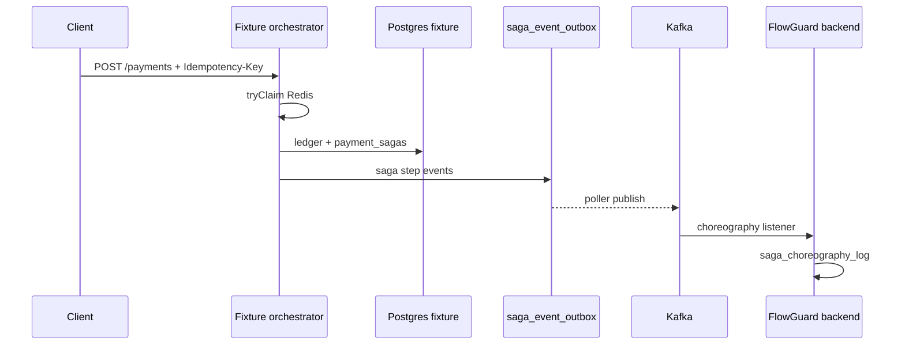

# Saga orchestration and choreography (payments)

## Overview

Fixture-wallet runs **orchestrated** payment sagas: risk → idempotency claim → account lock → ledger commit → idempotency confirm → settlement event. Each step updates `fixture.payment_sagas` and enqueues **choreography** events in `fixture.saga_event_outbox` (transactional outbox). **Settlement** events (`PAYMENT_SETTLED`, etc.) use `transaction_event_outbox` the same way. Pollers publish to Kafka (`flowguard.saga.events`, `flowguard.transactions`). Failed publishes retry; after max attempts rows move to **DLQ** tables with metrics `flowguard.fixture.saga_outbox.dlq` and `flowguard.fixture.transaction_outbox.dlq`.

FlowGuard backend **consumes** those events (idempotent append) into `metadata.saga_choreography_log`.



## Duplicate protection

- **Redis idempotency** (`reference-safe` + Redis): `tryClaim` → `PENDING`; concurrent duplicate keys → **409** `IDEMPOTENCY_IN_PROGRESS`; after success `confirm`; retries **replay** without double credit.
- **Claim before saga row**: avoids unique-index races on active `payment_sagas.idempotency_key`.
- **DB**: unique payments idempotency + `FOR UPDATE` on safe credit path.
- **Account lock**: Redis `lock:account:{id}` when Redis idempotency enabled.

## Compensation and recovery

- Failure after ledger commit: `reverseIfSettled`, release idempotency key, saga `COMPENSATING` → `COMPENSATED` → `FAILED`.
- **Stale saga reaper** (scheduled): fails sagas inactive longer than `flowguard.fixture.stale-saga-minutes` and releases Redis claims.

## API

| Endpoint | Purpose |
|----------|---------|
| Fixture `POST /payments` | Credit; `Idempotency-Key` header or body `idempotencyKey` |
| Fixture `GET /internal/sagas/idempotency/{key}` | Orchestrator state rows |
| Backend `GET /api/v1/sagas/trace/idempotency/{key}` | Choreography event log (`GlobalResponse`) |
| Backend `GET /api/v1/sagas/verify/idempotency/{key}` | Pass/fail + event types |
| Investigation | After each probe with `idempotencyKey` in measurement → SSE `saga.trace.verified` |
| UI | Investigation detail → **Saga choreography** panel · **Ops** (`/ops`) DLQ replay |
| Backend ops | `GET/POST /api/v1/ops/outbox/*`, `GET /api/v1/ops/sagas/choreography-gaps` |
| Monitoring | Prometheus `:9090`, Grafana `:3000` — see [MONITORING.md](MONITORING.md) |

## Metrics (Prometheus)

- Fixture: `flowguard.fixture.saga.completed`, `.replay`, `.in_progress_rejected`, `.compensated`, `.reaped`, `saga_outbox.dlq`, `transaction_outbox.dlq`
- Backend: `flowguard.saga.choreography.duplicate_skipped`

## Variants

- `dup-credit-vulnerable`: Redis idempotency/locks **off** (Day 2 race lab).
- `reference-safe` + messaging: full saga, outbox, choreography (production E2E).

## Verification

```powershell
.\gradlew.bat :fixture-wallet:test :benchmarks:baseline:baselineFreeze :integration:e2eProduction
```
